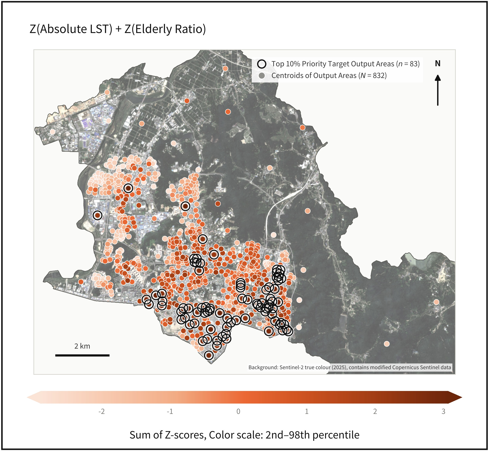
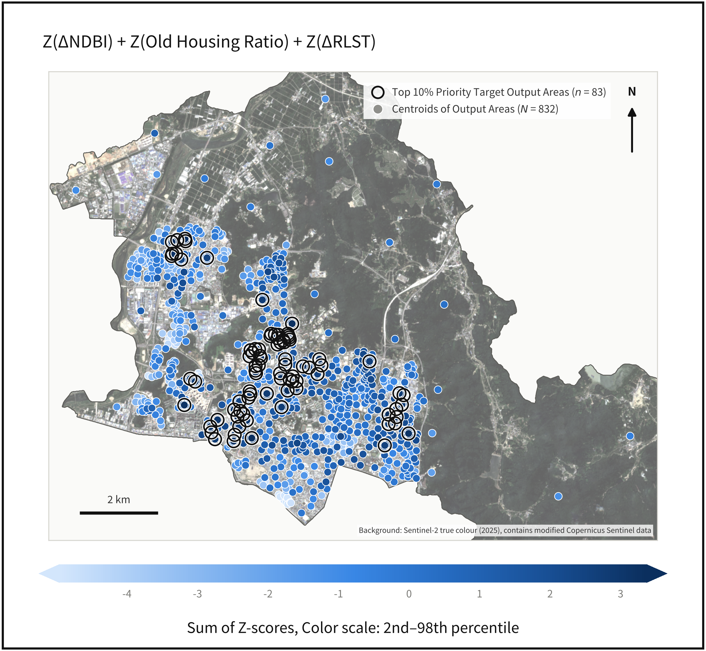

| 원고 Fig. 2 — Track 1 | 원고 Fig. 3 — Track 2 |
| :---: | :---: |
|  |  |

> **Fig. 2 · Fig. 3** 논문에 수록된 그림 파일입니다. Track 점수를 집계구 중심점(N=832)에 색상 단계(2~98 백분위)로 표시하고, 상위 10%(n=83) 집계구를 원으로 강조하였습니다. 배경은 Sentinel-2 2025년 실사 영상이며, `analysis/05_figures.py`로 동일한 파일을 다시 만들 수 있습니다.

# 🌡️ 광주광역시 북구 도심 열환경 및 다차원 기후 취약성 분석
(Urban Heat Environment and Climate Vulnerability Analysis in Buk-gu, Gwangju)

본 저장소는 구글 어스 엔진(Google Earth Engine, GEE) 기반 다중위성 자료와 통계청 집계구 자료를 결합하여 도심 열섬(UHI)의 공간 패턴을 분석하고, 기후위기 적응 정책의 우선순위(투트랙 타겟팅)를 도출한 논문의 분석 코드와 데이터를 제공합니다.

> **📌 2026-10-13 v3 안내 — 논문 수정본의 모든 수치는 v3 기준입니다.**
> 1. **집계구 물리변수 재산출:** 100m 격자값의 평균 대신 GEE에서 집계구 폴리곤 위 **면적 가중 구역평균**(10m, EPSG:5179)으로 산출하였습니다. 화소 중심점 규칙에서 값이 비던 소면적 집계구가 포함되어 분석 집계구가 **691개 → 832개(북구 인구의 91.4%)** 로 늘었습니다.
> 2. **NDBI 수정:** Landsat 8 C2 L2 지표반사율 변환(DN × 0.0000275 − 0.2) 후 NDBI를 산출하였습니다(기존은 원시 DN 기준).
> 3. **격자 표본:** 중심점이 SGIS 집계구 경계 안에 있는 격자만 사용하여 **11,752개**로 정리하였습니다.
> 4. **사회경제 지표:** 고령 인구 비율 = 65세 이상 인구 / 인구총괄 총인구, 노후 주택 비율 = 1999년 이전 건축 주택(건축 후 25년 이상) / 전체 주택. SGIS 비공개 셀(1~4호)은 2.5호로 대체하였습니다.
> 5. **공간가중행렬:** 집계구 폴리곤 경계 기준 Queen 인접(`data/queen_oa_v3.gal`, 고립 집계구 없음, 평균 이웃 5.5개)으로 다시 만들었습니다.
>
> v2 파일은 `archive/v2/`, 최초 버전은 `archive/v1/`에 보존되어 있습니다. 논문 수치 재현에는 사용하지 마십시오.

## 📂 파일 설명 (Files)

### GEE 스크립트 (gee/)
* `MAXLST추출`: 하절기 최고 지표면온도(Max LST) 산출 *(Fig. 1 시각화 전용)*
* `Mean LST+NDBI`: 하절기 평균 지표면온도(LST)와 상대 지표면온도(RLST) 산출 — 격자 분석의 LST·RLST 원본 *(NDBI 부분은 아래 재추출 스크립트로 대체)*
* `SAVI+DEM`: 토양조정 식생지수(SAVI)와 해발고도(DEM) 산출
* `ndbi_reextract_2020_2025.js`: **v3** 반사율 기준 NDBI·ΔNDBI를 100m 격자별로 재추출 → `data/Bukgu_NDBI_2020_2025_100m_grid.csv`
* `oa_zonal_areaweighted.js`: **v3** 919개 집계구별 면적 가중 구역평균(LST, RLST, NDBI, SAVI, DEM)과 Queen 인접 목록 → `data/Bukgu_OA_zonal_areaweighted.csv`, `data/Bukgu_OA_queen_neighbors.csv`

> GEE 스크립트의 경계 자산(`projects/lateral-plane-500605-i8/assets/...`)은 작성자 계정의 자산입니다. 재실행하려면 SGIS 집계구 경계(2025년 2분기)와 읍면동 경계를 본인 GEE 자산으로 올린 뒤 경로를 바꾸어 주십시오.

### 데이터 (data/)
| 파일 | 내용 |
| :--- | :--- |
| `전체종합_구역통계-빈셀 제거.csv` | 100m 격자 구역통계 원본(N=11,809): LST·RLST·SAVI·DEM |
| `Bukgu_NDBI_2020_2025_100m_grid.csv` | 격자별 반사율 기준 NDBI 2020·2025, ΔNDBI (GEE 산출) |
| `grid_oa_map.csv` | 격자 → 집계구 코드 매핑 (격자 중심점이 속한 집계구) |
| `Bukgu_Grid_Master_v3.csv` | **격자 분석 정본 (N=11,752)** — 3.2절, Table 2·3, 부록 Panel A |
| `Bukgu_OA_zonal_areaweighted.csv` | 919개 집계구 면적 가중 구역평균 (GEE 산출) |
| `Bukgu_OA_queen_neighbors.csv` | 집계구 Queen 인접 목록 (GEE 산출) |
| `2024 고령인구비율.xlsx` | SGIS 2024 성·연령별 인구 (65세 이상 = in_age_014~021) |
| `sgis_2024_total_population.csv` | SGIS 2024 인구총괄 총인구(to_in_001) |
| `sgis_2024_housing_by_year.csv` | SGIS 2024 건축연도별 주택 (ho_yr_001~003 = 1999년 이전) |
| `dong_names.json` | 행정동 코드 → 행정동명 |
| `Bukgu_OA_Master_v3_base.csv` | 집계구 분석 표본(N=832), 표준화 전 |
| `Bukgu_OA_Master_v3.csv` | **집계구 분석 정본 (N=832)** — Z-점수, Track 점수·순위 포함. 3.3~3.5절, Table 4~9, 부록 Panel B |
| `queen_oa_v3.gal` | 832개 집계구 Queen 공간가중행렬 (GeoDa/PySAL 호환 GAL) |
| `z_score_v3.xlsx` | 집계구 정본 + Track별 상위 10% 목록 + 두 트랙 공통 집계구 + 강건성 요약 |
| `basemap/Sentinel2_TrueColor_2025_Bukgu.tif` | Fig. 2·3 배경 영상 (Sentinel-2 2025 실사, EPSG:4326) |

### 분석 코드 (analysis/) — 저장소 최상위 폴더에서 순서대로 실행
| 스크립트 | 내용 | 산출물 |
| :--- | :--- | :--- |
| `01_build_grid_master.py` | 격자 구역통계 + 반사율 NDBI + 집계구 매핑 결합, 표본 정리 | `data/Bukgu_Grid_Master_v3.csv` |
| `02_grid_models.py` | 격자 OLS·VIF, 잔차 Moran's I, GM 공간오차모형, 경계 격자 제외 강건성 | `results/grid_results.json` |
| `03_build_oa_master.py` | GEE 구역평균 + SGIS 인구·주택 결합, 제외 기준 적용, Queen GAL 생성 | `data/Bukgu_OA_Master_v3_base.csv`, `data/queen_oa_v3.gal` |
| `04_oa_models_and_tracks.py` | 집계구 OLS·SEM·SLM, LM 검정, Track 1·2 점수, 강건성(MAD·winsorizing·PCA·ΔNDBI 제외·비공개 셀 0 처리) | `data/Bukgu_OA_Master_v3.csv`, `data/z_score_v3.xlsx`, `results/oa_results.json` |
| `05_figures.py` | Fig. 2·3 (배경 없이: `--no-basemap`) | `figs/Fig2_Track1.jpg`, `figs/Fig3_Track2.png` |
| `spatial_models.py`, `tm5179.py` | 공간계량 함수(numpy/scipy), EPSG:5179 좌표 변환 | — |

### 그림 (figs/)
* `Fig1_LST_3D_Topography.jpg`: 원고 Fig. 1 (2025 하절기 Max LST + 3D 지형)
* `Fig2_Track1.jpg`: 원고 Fig. 2 — Track 1(단기 구호형) 우선 타겟 집계구
* `Fig3_Track2.png`: 원고 Fig. 3 — Track 2(중장기 개조형) 우선 타겟 집계구

## 📊 데이터 명세서 (Data Dictionary) — `Bukgu_OA_Master_v3.csv`
모든 물리 변수는 집계구 폴리곤과 화소가 겹치는 면적으로 가중한 구역평균입니다.

| 변수명 | 설명 | 취약성 지표 |
| :--- | :--- | :--- |
| `TOT_OA_CD`, `ADM_CD`, `Admin` | 집계구 코드(14자리), 행정동 코드, 행정동명 | - |
| `cx`, `cy` | 집계구 중심 좌표 (EPSG:5179) | - |
| `Abs_mean` | 2025년 하절기 평균 절대 지표면온도 (℃) | 노출도 (Track 1) |
| `dRL_mean` | 2020→2025 상대 지표면온도 변화량 (ΔRLST) | 노출도 (Track 2) |
| `dNB_mean` | 2020→2025 건물 밀도 변화량 (ΔNDBI, 반사율 기준) | 노출도 (Track 2) |
| `SAVI` | 2025년 토양조정 식생지수 (5~10월 최댓값 합성) | 통제변수 |
| `DEM` | 평균 해발고도 (m) | 통제변수 |
| `Elderly_Ratio` | 고령 인구 비율 (%) = 65세 이상 / 총인구 × 100 | 민감도 (Track 1) |
| `Old_housing_Ratio` | 노후 주택 비율 (%) = 1999년 이전 건축 주택 / 전체 주택 × 100 | 적응 능력 (Track 2) |
| `to_in_001`, `eld65`, `house_old`, `house_tot` | 총인구, 65세 이상 인구, 노후 주택 수, 전체 주택 수 | - |
| `valid20`, `valid25` | 집계구 면적 중 유효 지표면온도 화소 비율 | - |
| `Z_*` | 각 지표의 Z-점수 (N=832 기준) | - |
| `Track1_Score`, `Track2_Score` | Track 1·2 Z-점수 합산 | - |
| `Track1_Rank`, `Track2_Rank`, `Track1_Top10`, `Track2_Top10` | 순위와 상위 10%(83개) 여부 | - |

> *Track 1 = `Z_Abs` + `Z_Elderly` / Track 2 = `Z_dNB` + `Z_Old` + `Z_dRL`*

## 📈 논문 대응 주요 결과 (v3)

| 항목 | 값 |
| :--- | :--- |
| 격자 회귀 (3.2절, N=11,752) | R² = .175, F(5, 11746) = 497.9, 최대 VIF 4.29 |
| 격자 OLS 계수 | ΔSAVI −6.564\*\*\*, SAVI2020 −8.426\*\*\*, RLST2020 −0.251\*\*\*, ΔNDBI −0.948\*, DEM 3.41e-6 (ns) |
| 격자 공간오차모형 (GM) | 잔차 Moran's I .816 → λ = .938, ΔSAVI −1.387\*\*\*, SAVI2020 −0.975\*\*\*, ΔNDBI 3.289\*\*\* |
| 경계 격자 추가 제외 (N=11,370) | OLS ΔNDBI −0.147 (p = .758), 공간오차모형 ΔNDBI 3.215\*\*\* |
| 집계구 회귀 (3.3절, N=832) | R² = .595, F(5, 826) = 242.5, 최대 VIF 1.65 |
| 집계구 OLS 계수 | ΔNDBI 6.762\*\*\*, 고령비율 0.0709\*\*\*, 노후주택 −0.0036\*, SAVI −23.025\*\*\*, DEM −0.0131\*\*\* |
| 집계구 공간모형 | 잔차 Moran's I .508 → SEM λ = .886 (AIC 2579), SLM ρ = .655 (AIC 2636), OLS AIC 3289; SEM 잔차 I = −.031 (p = .159) |
| 무조건부 상관 | r(절대온도, 고령비율) = .275, r(절대온도, 노후주택) = .226, r(ΔNDBI, ΔRLST) = .308 |
| r(Track 1, Track 2) | .526, 상위 10% 중첩 14/83 (16.9%) |
| Track 2 강건성 (ρ, 상위 10% 중첩) | MAD .982 (91.6%) / winsorizing .993 (94.0%) / PCA .992 (98.8%) / ΔNDBI 제외 .906 (66.3%) / 비공개 셀 0 처리 .995 (97.6%) |
| Track 1 강건성 (ρ, 상위 10% 중첩) | MAD 1.000 (98.8%) / winsorizing .992 (83.1%) |

## ⚙️ 재현 방법 (Reproduction)

```bash
pip install -r requirements.txt
bash run_all.sh            # 01 → 05 순서로 실행 (약 10초)
```

`results/*.json`에 모든 추정값이 저장되며, 실행 결과는 위 표와 논문 수치와 일치합니다. 공간가중행렬은 격자는 8방향 Queen 인접, 집계구는 `queen_oa_v3.gal`(행 표준화)을 사용합니다. GeoDa에서 같은 GAL 파일로 검정을 재현할 수 있습니다.

### 알려진 제약
* Landsat Collection 2 표면온도 산출물은 방사율 입력 자료(ASTER GED)가 없는 지점에서 모든 시점의 값이 비어 있습니다. 이 때문에 거주 집계구 67개(32,590명)는 분석에서 제외되었습니다. ([USGS 안내](https://www.usgs.gov/landsat-missions/landsat-collection-2-surface-temperature-data-gaps-due-missing-aster-ged))
* SGIS 집계구 자료는 5 미만의 값을 비공개 처리하므로 소규모 집계구의 고령 인구 비율과 노후 주택 비율에는 오차가 있을 수 있습니다.

## 📎 데이터 출처 (Data Sources)
* **위성 영상:** Google Earth Engine Data Catalog — Landsat 8 Collection 2 Level-2 (USGS), Harmonized Sentinel-2 Level-2A (ESA/Copernicus), SRTM 30m DEM (NASA)
* **인구·주택 통계:** 통계청 통계지리정보서비스(SGIS) 2024년 기준 집계구 자료
* **경계:** SGIS 집계구 경계(2025년 2분기), 읍면동 경계

## 📜 라이선스 (License)
본 저장소의 코드와 가공 데이터는 학술 목적으로 자유롭게 활용할 수 있습니다. 원천 데이터(인구·주택 통계)의 저작권과 활용 규정은 [통계청 SGIS](https://sgis.kostat.go.kr/) 정책을, 위성 영상은 각 제공 기관(USGS, ESA/Copernicus, NASA)의 정책을 따릅니다.
